<div align="center">

  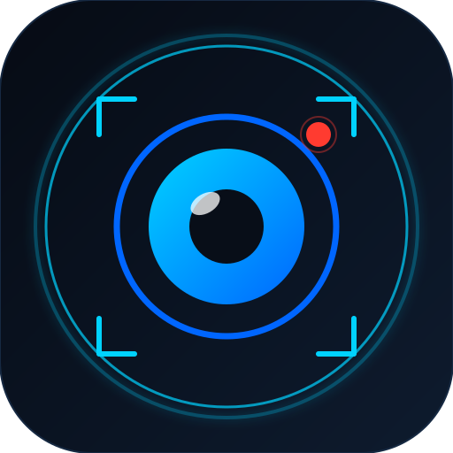

  # OmniCapture

  **A high-performance Windows toolkit for Android screen mirroring, stealth camera capture, direct-to-PC recording, and cloud synchronization.**

  [](https://github.com/rajvisual/OmniCapture/releases/latest)
  [](https://python.org)
  [](https://microsoft.com/windows)
  [](https://github.com/Genymobile/scrcpy)
  [](#license)
  [](CONTRIBUTING.md)

  <br />

  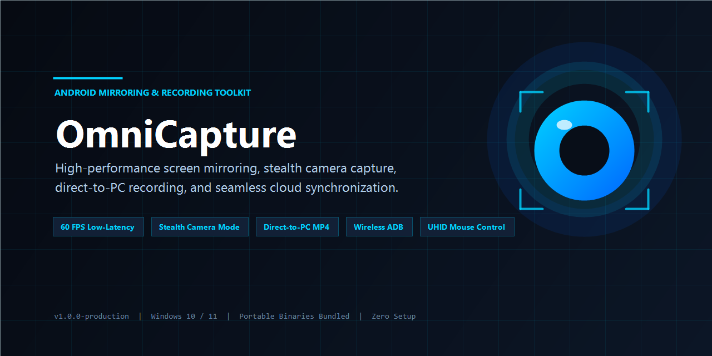

</div>

---

## ⚡ Public Editions & Download

OmniCapture is maintained in **two distinct public editions** to serve both graphical workflow creators and terminal automation engineers:

| Edition | Version | Interface | Best For | Requirements | Download & Run |
| :--- | :--- | :--- | :--- | :--- | :--- |
| **OmniCapture Studio** | **v1.4.0** *(Pre-Release)* | **Modern Desktop GUI** | Content creators, educators, and streamers needing live multi-scene viewfinders, audio meters, crash survival, and 1-click recording. | Windows 11 / 10 64-bit<br>• Android phone (USB/Wi-Fi)<br>• FFmpeg installed | [📥 Download v1.4.0 Portable (.zip)](https://github.com/rajvisual/OmniCapture/releases/download/v1.4.0/OmniCapture-Studio-v1.4.0-Windows-x64-Portable.zip)<br>Run `OmniCapture.exe` |
| **OmniCapture Classic** | **v1.1.0** *(Stable)* | **Terminal / CLI Only** | Developers, automation scripts, minimal headless rigs, and users who prefer a pure terminal menu with zero GUI overhead. | Windows 10 / 11<br>• Python 3.10+ or portable<br>• Android phone | [📥 View v1.1.0 Classic Release](https://github.com/rajvisual/OmniCapture/releases/tag/v1.1.0)<br>Run `python omni.py` |

> [!NOTE]
> **FFmpeg Requirement for Studio Edition**:
> Until the standalone installer bundles FFmpeg directly, PC screen capture requires FFmpeg in your system PATH or `bin/` directory. Install it in one command via PowerShell:
> ```powershell
> winget install Gyan.FFmpeg
> ```

---

## 📸 Studio Visual Showcase

> [!TIP]
> **Live Desktop Screenshot Placement**:
> Screen captures below are captured directly from real Windows 11 desktop sessions to prevent offscreen PrintWindow artifacts. To generate your own fresh captures from your local monitor:
> ```powershell
> python scripts/user_qa_screenshots.py
> ```
> *Captured images will be saved directly to `docs/qa_shots/`.*

| Dark Liquid Glass Theme (Default) | Light Minimal Theme (Solid Fluent Light) |
| :---: | :---: |
| 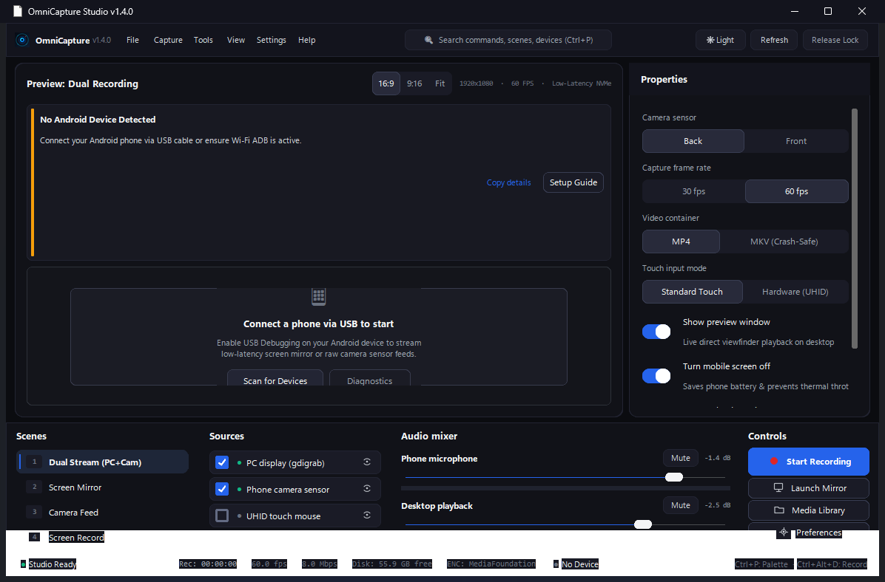 | 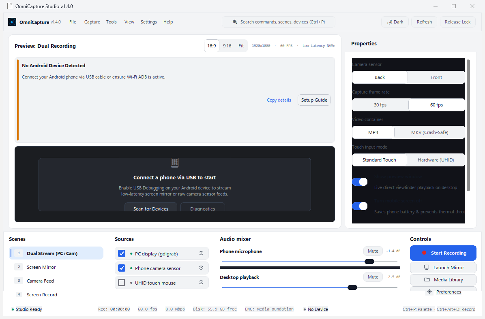 |

---

## ⌨️ Studio Keyboard Shortcuts & Hotkeys

All hotkeys are scoped cleanly to prevent recording interruptions:

| Shortcut | Scope | Action Performed |
| :--- | :--- | :--- |
| **`Ctrl + Alt + D`** | **Global** (System-wide) | Start / Stop Dual Recording (PC Screen + Mobile Camera) |
| **`Ctrl + Alt + M`** | **Global** (System-wide) | Launch Android Display Mirror with interactive touch control |
| **`Ctrl + Alt + C`** | **Global** (System-wide) | Launch Camera Viewfinder (Powers off mobile screen for stealth) |
| **`Ctrl + Alt + R`** | **Global** (System-wide) | Open Recordings folder in Windows Explorer |
| **`Ctrl + P` / `Ctrl + K`** | In-App | Open Studio Command Palette for fuzzy action navigation |
| **`1` / `2` / `3` / `4`** | In-App | Switch Active Scene (`Dual`, `Mirror`, `Camera`, `Screen`) *(unfocused)* |
| **`F5`** | In-App | Refresh connected Android devices & query battery telemetry |
| **`Ctrl + Shift + L`** | In-App | Release camera sensor hardware lock held by phone background apps |
| **`Ctrl + ,`** | In-App | Open Studio Preferences Dialog |
| **`Alt + F / C / T / V / S / H`** | In-App | Windows Standard Menu Mnemonics (`File`, `Capture`, `Tools`, `View`, `Settings`, `Help`) |
| **`Ctrl + W`** | In-App | Minimize application to Windows System Tray |
| **`Ctrl + Q`** | In-App | Exit Application *(Prompts confirmation if recording is active)* |
| **`Escape`** | In-App | Dismiss active menu, palette, or dialog **(NEVER stops recording)** |

---

## Overview

**OmniCapture** is an open-source, portable Windows desktop suite that transforms any modern Android device into a low-latency secondary display, remote camera viewfinder, or live capture source without installing mobile companion apps or granting root access.

Built on top of a bundled, zero-configuration `scrcpy` and Android Debug Bridge (`adb`) runtime, OmniCapture optimizes video pipelines for ultra-low latency (<25ms) at 60 FPS. It features a direct-to-NVMe recording pipeline that bypasses mobile storage constraints, stealth camera streaming that powers down the phone's physical display during operation, Linux kernel UHID hardware mouse emulation, simultaneous PC + mobile dual recording, and hybrid Google Drive synchronization.

---

## Visual Showcase

<div align="center">

### OmniCapture Studio v1.4.0 (Windows 11 Broadcast Workstation)
| Dark Liquid Glass Theme (Mica & Specular Alpha) | Light Minimal Theme (Solid Fluent Light) |
| :---: | :---: |
|  |  |

| Synchronized Active Recording HUD | Command Palette (Ctrl+P Fuzzy Search) |
| :---: | :---: |
| 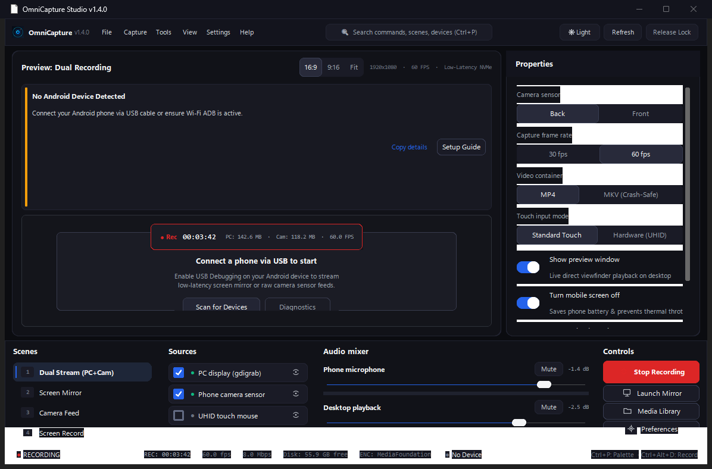 | 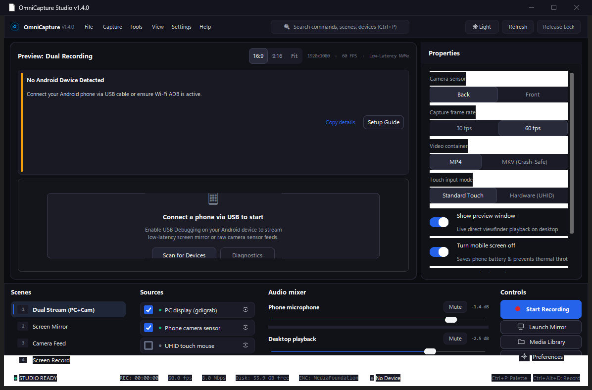 |

### Interactive Terminal Dashboard & Diagnostics (Classic Edition)
| Terminal Interactive Dashboard | Camera2 API Hardware Diagnostics |
| :---: | :---: |
| 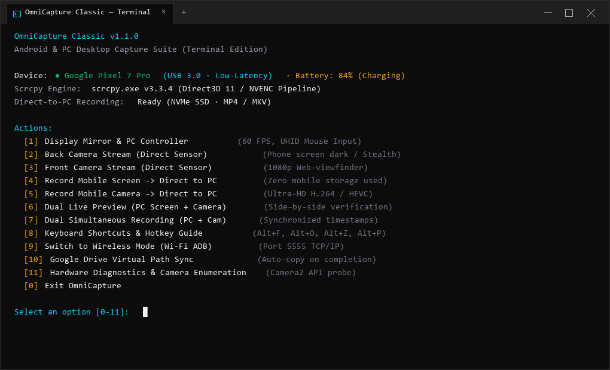 | 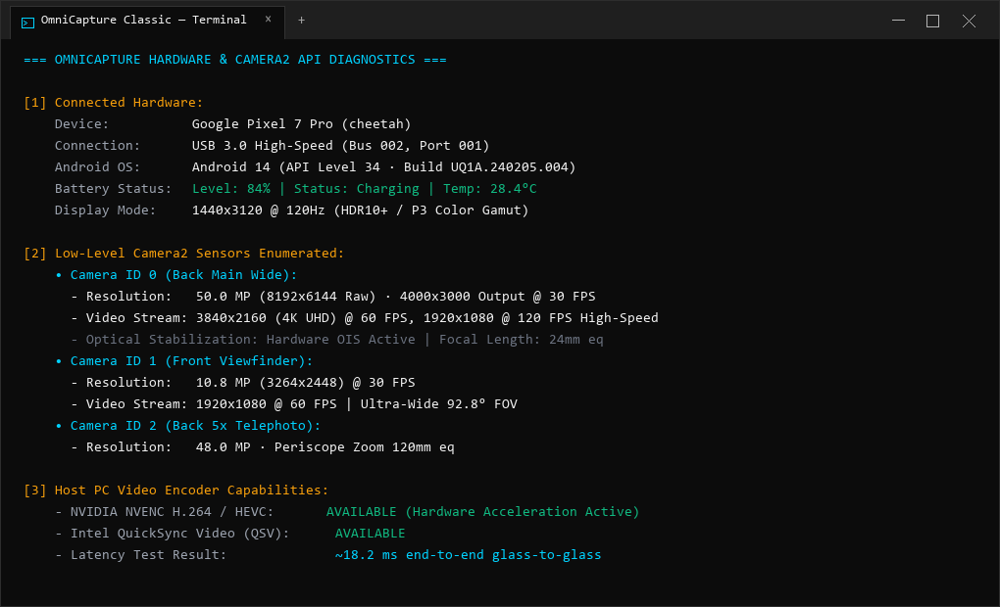 |

### Live Capture & Direct-to-PC Recording
| 60 FPS Low-Latency Display Mirroring | Stealth Camera Remote Viewfinder |
| :---: | :---: |
| 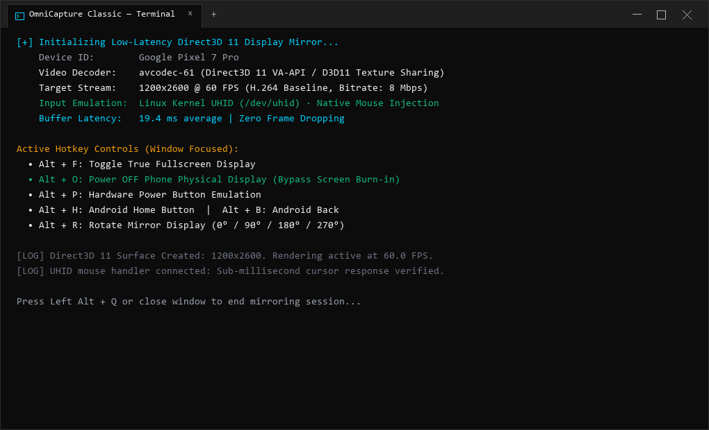 | 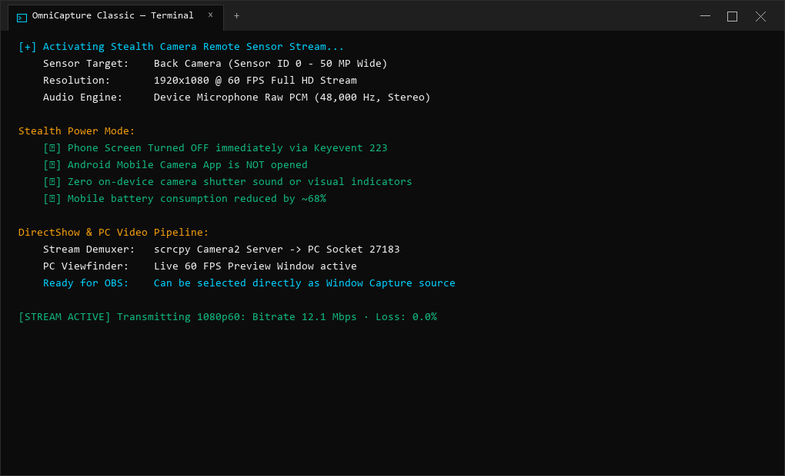 |

| Direct-to-PC Recording & Cloud Sync HUD |
| :---: |
| 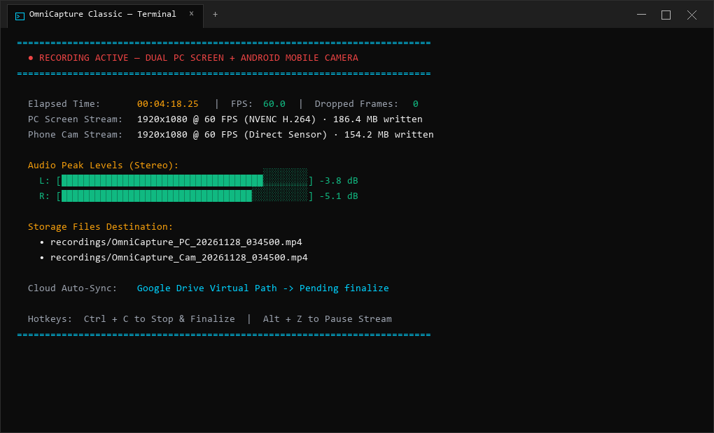 |

</div>

---

## Key Features

### 1. Modern Windows 11 Dark Mode Desktop Dashboard (GUI)
- **Fluent Dark Aesthetics**: Built with `customtkinter` featuring dynamic telemetry cards, live device connectivity badges, and instant 1-click capture.
- **Creator Hero Mode (Dual Simultaneous Recording)**: 1-click synchronized PC screen and mobile camera recording with live elapsed timer, real-time file size monitors, and instant stop/finalize.
- **System Tray Integration**: Minimize to Windows System Tray on close to keep OmniCapture ready in the background with zero desktop clutter.
- **Global Windows Hotkeys**: Trigger actions from anywhere in Windows even when OmniCapture is minimized:
  - `Ctrl + Alt + D`: Quick Dual Simultaneous Recording start / stop.
  - `Ctrl + Alt + M`: Quick Display Mirror & PC Touch Controller.
  - `Ctrl + Alt + C`: Quick Stealth Camera Viewfinder.
  - `Ctrl + Alt + R`: Open Recordings Folder in Windows Explorer.
- **Recordings Gallery**: Integrated media manager with 1-click video playback in your default media player, folder explorer, and Google Drive upload.
- **Zero-Install Standalone `.exe`**: Portable distribution available in `dist/OmniCapture/OmniCapture.exe` bundling the Python runtime, dependencies, and binaries.

### 2. Ultra Low-Latency Screen Mirroring (60 FPS)
- **H.264 / H.265 Hardware Pipeline**: Streams your Android display to your Windows PC with glass-to-glass latency under 25ms.
- **Adaptive Resolution Profiling**: Defaulted to `1200` max dimension and `8 Mbps` bitrate to prevent MediaCodec buffer exhaustion on mid-range and budget SoCs (e.g., Qualcomm Snapdragon 662/680).
- **Full PC Keyboard & Mouse Passthrough**: Type using your physical keyboard, drag and drop files, and synchronize your PC clipboard bidirectionally.

### 3. Stealth Background Camera Streaming
- **Zero Mobile UI**: Access the phone's camera sensors directly via Android's low-level Camera2 API without launching the phone's Camera application.
- **Screen-Off Operation**: Automatically puts the phone screen to sleep using stealth keyevent signals (`KEYCODE_SLEEP`), slashing battery consumption and heat generation by over 60%.
- **Multi-Sensor Selection**: Easily switch between Wide Back (`--camera-id=0`), Ultra-Wide, Front Selfie (`--camera-id=1`), or Macro lenses.

### 4. Unlimited Direct-to-PC Recording
- **Bypass Mobile Storage**: Streams are demuxed and written in real time directly to your PC's NVMe or SSD storage (`recordings/`).
- **Standard Video Containers**: Save files as standard `.mp4` or robust `.mkv` files with custom frame rates (30/60 FPS).
- **Headless Recording**: Support for `--no-playback` background capture without opening an active preview window on your desktop.

### 5. Dual Simultaneous Recording (PC Screen + Mobile Camera -> 2 Separate Files)
- **Concurrent Dual Capture**: Records your full Windows desktop display and mobile camera feed at the exact same time into **two separate, dedicated video files** (`REC_PC_SCREEN_*.mp4` and `REC_MOBILE_CAMERA_*.mp4`).
- **Creator & Gaming Ready**: Ideal for video tutorials, streaming, and content creation where having isolated tracks allows flexible editing, repositioning, and reframing without fixed PiP overlay destruction.
- **Synchronized Session Control**: Press `Enter` or `Ctrl+C` in the terminal (or click Stop in GUI) to cleanly finalize and stop both streams simultaneously.
- **Stealth Mobile Display**: Phone display remains turned off during recording to conserve battery and eliminate heat.

### 6. Linux Kernel UHID Input Mode (Xiaomi / POCO Fix)
- **Bypass OEM Security Locks**: Xiaomi MIUI and HyperOS devices block standard ADB touch injection (`java.lang.SecurityException: Injecting to another application requires INJECT_EVENTS permission`).
- **Hardware Simulation**: The `--uhid` flag registers a virtual USB HID mouse and keyboard directly at the Linux kernel level (`/dev/uhid`), providing immediate, stutter-free mouse control without enabling obscure developer account settings.

### 7. Hybrid Google Drive Cloud Synchronization
- **Option A (Zero Overhead)**: Automatically copies completed recordings to your local Google Drive for Desktop virtual drive (`G:\My Drive\OmniCapture`).
- **Option B (REST API v3)**: Standalone OAuth 2.0 chunked resumable upload engine that uploads large video files in the background without needing Google Drive desktop software installed.

### 8. One-Click Wireless Mode (Wi-Fi ADB)
- Automatically queries your device's active local IP address via `ip route`, initializes port `5555` TCP/IP listening, and switches to wireless streaming so you can unplug your USB cable.

---

## Keyboard Hotkey Quick Reference

OmniCapture configures **Left Alt (`lalt`)** as the primary shortcut modifier:

| Shortcut | Action | Description |
| :--- | :--- | :--- |
| `Left Alt + F` | **Fullscreen** | Toggle fullscreen mirror display |
| `Left Alt + P` | **Screen Power** | Toggle physical phone screen on / off |
| `Left Alt + O` | **Mirror Screen Off** | Keep mirror stream alive while turning mobile display off |
| `Left Alt + R` | **Pause / Resume** | Pause or resume active recording stream |
| `Left Alt + H` | **Home Button** | Simulate Android Home navigation |
| `Left Alt + B` | **Back Button** | Simulate Android Back navigation |
| `Left Alt + S` | **App Switcher** | Open Android recent apps overview |
| `Left Alt + N` | **Notification Shade** | Pull down Android notification panel |
| `Left Alt + Up / Down` | **Volume Control** | Adjust device media volume up or down |
| `Left Alt + C` | **Copy Clipboard** | Pull mobile device clipboard to PC |
| `Left Alt + V` | **Paste Clipboard** | Push PC clipboard text to mobile device |

---

## Installation & Setup

### 1. Prerequisites
- **Windows 10 or Windows 11 (64-bit)**
- **Python 3.10+**: Download from [python.org](https://www.python.org/downloads/). (Make sure to check *"Add python.exe to PATH"* during setup).
- **Android Device**: Android 5.0+ (Android 12+ recommended for Camera2 API and microphone capture).

> [!NOTE]
> OmniCapture ships with pre-bundled, tested versions of `scrcpy` and `adb` in `bin/`. You **do not** need to download or install FFmpeg, scrcpy, or Android Platform Tools separately.

### 2. Enable Android USB Debugging
1. Open your phone's **Settings** > **About Phone**.
2. Tap **Build Number** 7 times until you see *"You are now a developer!"*.
3. Go back to **Settings** > **System / Additional Settings** > **Developer Options**.
4. Enable **USB Debugging**.
5. Connect your phone to your PC via a USB data cable and tap **Allow** on the prompt on your phone screen.
6. *(Xiaomi / POCO Users)*: Either enable **USB debugging (Security settings)** or simply use OmniCapture's `--uhid` flag.

### 3. Clone and Run
Open PowerShell and run:

```powershell
# Clone the repository
git clone https://github.com/rajvisual/OmniCapture.git
cd OmniCapture

# (Optional) Install dependencies for GUI and cloud features
pip install -r requirements.txt

# Launch Windows 11 GUI Dashboard
.\omni-gui.bat
# Or launch interactive terminal menu:
.\omni.bat
```

---

## Global System Shortcuts & Hotkeys

OmniCapture supports system-wide global shortcuts that work even when the app is minimized to the Windows System Tray:

| Shortcut | Action | Description |
| :--- | :--- | :--- |
| `Ctrl + Alt + D` | **Quick Dual Recording** | Start or stop concurrent PC screen + mobile camera recording |
| `Ctrl + Alt + M` | **Display Mirror** | Instantly launch 60 FPS display mirror & controller |
| `Ctrl + Alt + C` | **Stealth Camera** | Launch background camera viewfinder with screen off |
| `Ctrl + Alt + R` | **Recordings Folder** | Open the `recordings/` folder in Windows File Explorer |

While a streaming or mirror window is focused, **Left Alt (`lalt`)** controls the live feed:

| Shortcut | Action | Description |
| :--- | :--- | :--- |
| `Left Alt + F` | **Fullscreen** | Toggle fullscreen mirror display |
| `Left Alt + P` | **Screen Power** | Toggle physical phone screen on / off |
| `Left Alt + O` | **Mirror Screen Off** | Keep mirror stream alive while turning mobile display off |
| `Left Alt + R` | **Pause / Resume** | Pause or resume active recording stream |
| `Left Alt + H` | **Home Button** | Simulate Android Home navigation |
| `Left Alt + B` | **Back Button** | Simulate Android Back navigation |
| `Left Alt + S` | **App Switcher** | Open Android recent apps overview |
| `Left Alt + N` | **Notification Shade** | Pull down Android notification panel |
| `Left Alt + Up / Down` | **Volume Control** | Adjust device media volume up or down |
| `Left Alt + C` | **Copy Clipboard** | Pull mobile device clipboard to PC |
| `Left Alt + V` | **Paste Clipboard** | Push PC clipboard text to mobile device |

---

## Standalone Zero-Install Portable Executable

OmniCapture can be built into a standalone, portable Windows application (`dist/OmniCapture/OmniCapture.exe`) requiring zero Python installation on target machines:

```powershell
python scripts/build_standalone.py
```

The resulting distribution folder in `dist/OmniCapture/` is 100% self-contained and can be copied to any USB drive or Windows PC.

---

## Command-Line Usage

OmniCapture can be run via GUI, interactive terminal menu, or scriptable CLI arguments:

```powershell
# Launch Modern Windows 11 GUI Dashboard
python omni.py gui
# Or use the --gui flag
python omni.py --gui

# Launch Interactive Terminal Menu
python omni.py
# 1. Interactive Terminal Dashboard
python omni.py

# 2. Display Mirroring with UHID Mouse Control
python omni.py mirror --uhid

# 3. Mirror with Mobile Screen Powered Off (Maximum Stealth)
python omni.py mirror --screen-off

# 4. Stream Back Camera in 1080p @ 30 FPS
python omni.py camera --facing back --size 1920x1080 --fps 30

# 5. Stream Front Camera
python omni.py camera --facing front

# 6. Record Phone Screen Directly to PC (.mp4)
python omni.py record screen --format mp4

# 7. Record Camera Directly to PC with Auto Cloud Upload
python omni.py record camera --facing back --upload

# 8. Dual Simultaneous Record: PC Screen + Mobile Camera (2 Separate Files)
python omni.py dual-record --facing back --pc-fps 30 --camera-fps 30

# 9. Dual Record with Auto Google Drive Upload
python omni.py dual-record --upload

# 10. Run Hardware Diagnostics & Sensor Inspection
python omni.py info

# 11. Switch to Wireless Wi-Fi ADB Mode
python omni.py wireless
```

---

## Configuration (`config.json`)

OmniCapture loads configuration from `config.json` (template provided in `config.example.json`):

```json
{
  "scrcpy_dir": "bin",
  "recordings_dir": "recordings",
  "default_record_format": "mp4",
  "default_camera_facing": "back",
  "default_camera_fps": 30,
  "default_camera_size": "1920x1080",
  "max_size": 1200,
  "video_bit_rate": "8M",
  "max_fps": 60,
  "screen_off_during_capture": true,
  "stay_awake": false,
  "audio_source": "mic",
  "google_drive": {
    "enabled": false,
    "method": "desktop",
    "desktop_sync_path": "G:\\My Drive\\OmniCapture"
  }
}
```

---

## Troubleshooting

### Device Not Detected
- Verify your USB cable supports **data transfer** (some cables are charge-only).
- Re-plug the USB cable and verify that `Allow USB Debugging` appears on the phone screen.
- Run `python omni.py info` to inspect low-level ADB detection.

### Touch / Click Not Responding (Xiaomi / POCO / Redmi)
- MIUI and HyperOS block touch event injection by default.
- Pass `--uhid` or select **Option 1 (UHID Mode)** in the interactive menu to bypass the restriction at the kernel level.

### Video Lag or Frame Drops
- Lower the max resolution dimension by setting `"max_size": 1024` or `"video_bit_rate": "6M"` in `config.json`.
- Avoid USB 2.0 hubs; connect directly to a rear motherboard USB 3.0 port.

### Camera Sensor Busy / Hardware Lock
- If another app on your phone (e.g. Google Camera) holds the Camera2 hardware sensor lock, press **`Ctrl + Shift + L`** in OmniCapture or click **`Release Lock`** on the State Banner. OmniCapture will automatically invoke `am force-stop` on background clients.

For detailed debugging steps, see [docs/troubleshooting.md](docs/troubleshooting.md).

---

## ⚠️ Known Limitations

1. **Screen Reader (Windows UI Automation) Boundary**:
   - Tcl/Tk and CustomTkinter render widgets using internal canvas primitives and do not implement Microsoft UI Automation (UIA) or MSAA providers on Windows.
   - Windows Narrator cannot inspect inner canvas widgets, sliders, or segmented buttons. OmniCapture provides accessible fallbacks: 100% keyboard operability (Tab order, Space/Enter, arrow keys), visible 2px focus rings, live caption status updates (`WM_SETTEXT`), and native Windows Action Center notifications.
2. **Frosted Glass Approximation**:
   - Tk lacks a continuous hardware blur compositor. OmniCapture implements high-performance pre-blurred ambient snapshot slices for popups, which automatically fall back to solid flat surfaces during active recording to eliminate video encoder contention.

---

## 🗺️ Roadmap

- [x] **v1.0.0**: Bundled portable runtime (scrcpy 3.3.4 + ADB).
- [x] **v1.0.0**: 60 FPS low-latency display mirroring & stealth front/back camera streaming.
- [x] **v1.0.0**: Linux kernel UHID mouse/keyboard hardware simulation (bypasses Xiaomi/POCO locks).
- [x] **v1.1.0**: Dual simultaneous recording (PC Screen + Mobile Camera saved as 2 separate files).
- [x] **v1.2.0**: Modern Windows 11 GUI dashboard & system tray background service.
- [x] **v1.3.0**: Broadcast console with DAW audio mixer and Light/Dark Fluent design tokens.
- [x] **v1.4.0**: Recording crash-safety (MKV/fragmented MP4), Win32 Job Object process hygiene, 1366x768 adaptive ergonomics, 21-state matrix.
- [ ] **v1.5.0**: Zero-dependency Inno Setup Windows installer with bundled FFmpeg runtime.
- [ ] **v2.0.0**: Modernized Qt / WinUI 3 architecture with full native Microsoft UI Automation (UIA) providers.

---

## 📜 License & Third-Party Notices

OmniCapture is released under the **Apache License 2.0**. See [LICENSE](LICENSE) for full legal text.
For upstream third-party component licenses and attributions (scrcpy, ADB, CustomTkinter, Pillow, Pystray, FFmpeg), see [THIRD_PARTY_NOTICES.md](THIRD_PARTY_NOTICES.md).

---

<div align="center">
  <sub>Developed with precision for high-performance Android capture workflows.</sub>
</div>
