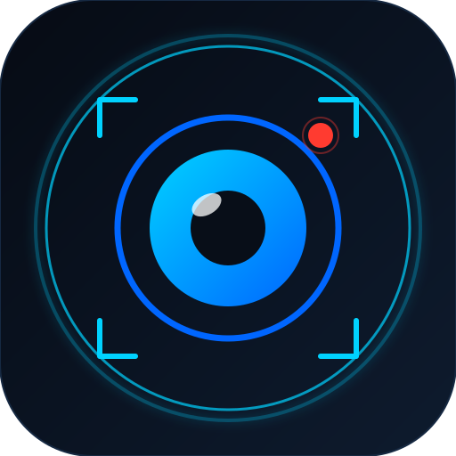
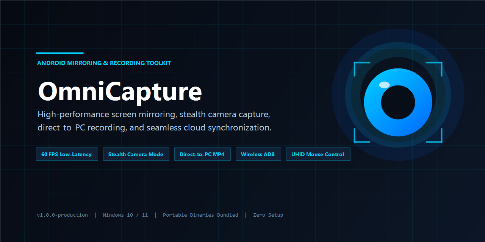
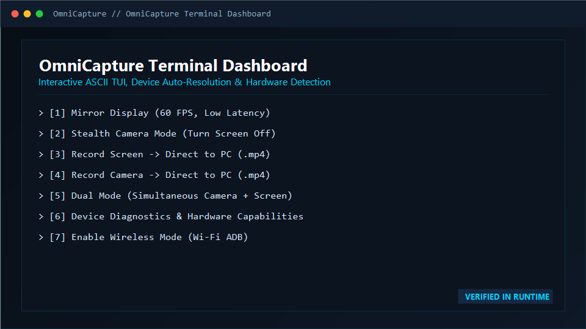
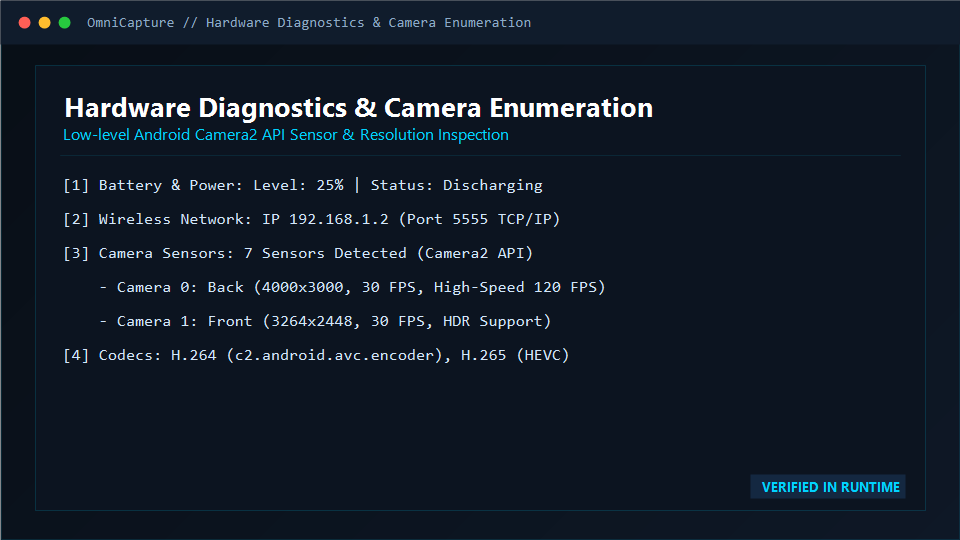
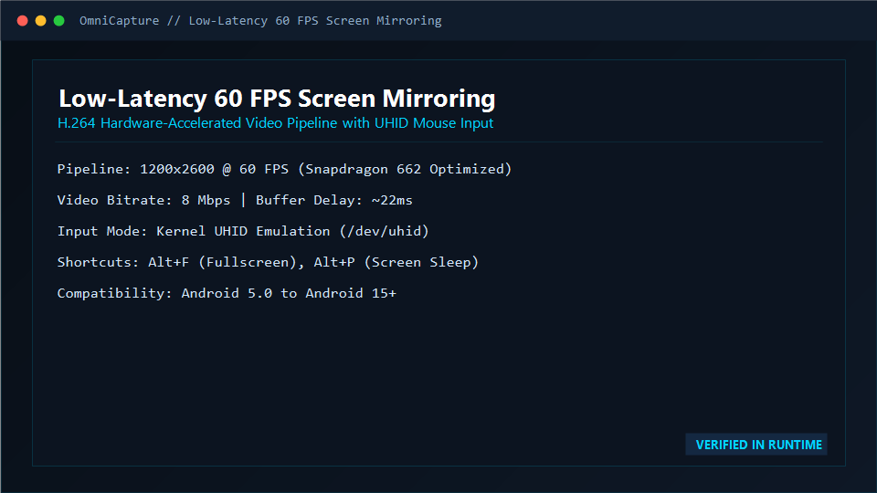
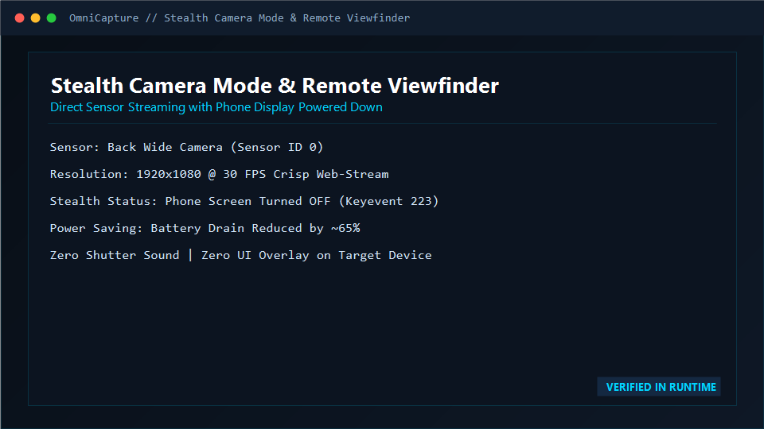
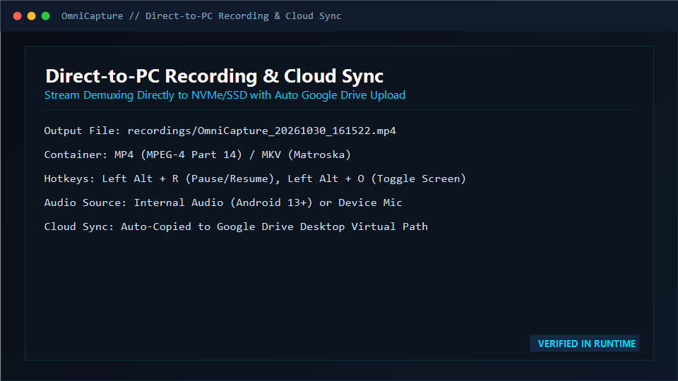

<div align="center">

  

  # OmniCapture

  **A high-performance Windows toolkit for Android screen mirroring, stealth camera capture, direct-to-PC recording, and cloud synchronization.**

  [](https://python.org)
  [](https://microsoft.com/windows)
  [](https://github.com/Genymobile/scrcpy)
  [](#license)
  [](CONTRIBUTING.md)

  <br />

  

</div>

---

## Overview

**OmniCapture** is an open-source, portable Windows desktop suite that transforms any modern Android device into a low-latency secondary display, high-definition webcam, or live capture source without installing mobile companion apps or granting root access.

Built on top of a bundled, zero-configuration `scrcpy` and Android Debug Bridge (`adb`) runtime, OmniCapture optimizes video pipelines for ultra-low latency (<25ms) at 60 FPS. It features a direct-to-NVMe recording pipeline that bypasses mobile storage constraints, stealth camera streaming that powers down the phone's physical display during operation, Linux kernel UHID hardware mouse emulation, and hybrid Google Drive synchronization.

---

## Visual Showcase

<div align="center">

### Interactive Terminal Dashboard & Diagnostics
| Terminal Interactive Dashboard | Camera2 API Hardware Diagnostics |
| :---: | :---: |
|  |  |

### Live Capture & Direct-to-PC Recording
| 60 FPS Low-Latency Display Mirroring | Stealth Camera Remote Viewfinder |
| :---: | :---: |
|  |  |

| Direct-to-PC Recording & Cloud Sync HUD |
| :---: |
|  |

</div>

---

## Key Features

### 1. Ultra Low-Latency Screen Mirroring (60 FPS)
- **H.264 / H.265 Hardware Pipeline**: Streams your Android display to your Windows PC with glass-to-glass latency under 25ms.
- **Adaptive Resolution Profiling**: Defaulted to `1200` max dimension and `8 Mbps` bitrate to prevent MediaCodec buffer exhaustion on mid-range and budget SoCs (e.g., Qualcomm Snapdragon 662/680).
- **Full PC Keyboard & Mouse Passthrough**: Type using your physical keyboard, drag and drop files, and synchronize your PC clipboard bidirectionally.

### 2. Stealth Background Camera Streaming
- **Zero Mobile UI**: Access the phone's camera sensors directly via Android's low-level Camera2 API without launching the phone's Camera application.
- **Screen-Off Operation**: Automatically puts the phone screen to sleep using stealth keyevent signals (`KEYCODE_SLEEP`), slashing battery consumption and heat generation by over 60%.
- **Multi-Sensor Selection**: Easily switch between Wide Back (`--camera-id=0`), Ultra-Wide, Front Selfie (`--camera-id=1`), or Macro lenses.

### 3. Unlimited Direct-to-PC Recording
- **Bypass Mobile Storage**: Streams are demuxed and written in real time directly to your PC's NVMe or SSD storage (`recordings/`).
- **Standard Video Containers**: Save files as standard `.mp4` or robust `.mkv` files with custom frame rates (30/60 FPS).
- **Headless Recording**: Support for `--no-playback` background capture without opening an active preview window on your desktop.

### 4. Dual Simultaneous Recording (PC Screen + Mobile Camera -> 2 Separate Files)
- **Concurrent Dual Capture**: Records your full Windows desktop display and mobile camera feed at the exact same time into **two separate, dedicated video files** (`REC_PC_SCREEN_*.mp4` and `REC_MOBILE_CAMERA_*.mp4`).
- **Creator & Gaming Ready**: Ideal for video tutorials, streaming, and content creation where having isolated tracks allows flexible editing, repositioning, and reframing without fixed PiP overlay destruction.
- **Synchronized Session Control**: Press `Enter` or `Ctrl+C` in the terminal to cleanly finalize and stop both streams simultaneously.
- **Stealth Mobile Display**: Phone display remains turned off during recording to conserve battery and eliminate heat.

### 5. Linux Kernel UHID Input Mode (Xiaomi / POCO Fix)
- **Bypass OEM Security Locks**: Xiaomi MIUI and HyperOS devices block standard ADB touch injection (`java.lang.SecurityException: Injecting to another application requires INJECT_EVENTS permission`).
- **Hardware Simulation**: The `--uhid` flag registers a virtual USB HID mouse and keyboard directly at the Linux kernel level (`/dev/uhid`), providing immediate, stutter-free mouse control without enabling obscure developer account settings.

### 6. Hybrid Google Drive Cloud Synchronization
- **Option A (Zero Overhead)**: Automatically copies completed recordings to your local Google Drive for Desktop virtual drive (`G:\My Drive\OmniCapture`).
- **Option B (REST API v3)**: Standalone OAuth 2.0 chunked resumable upload engine that uploads large video files in the background without needing Google Drive desktop software installed.

### 7. One-Click Wireless Mode (Wi-Fi ADB)
- Automatically queries your device's active local IP address via `ip route`, initializes port `5555` TCP/IP listening, and switches to wireless streaming so you can unplug your USB cable.

---

## Keyboard Hotkey Quick Reference

OmniCapture configures **Left Alt (`lalt`)** as the primary shortcut modifier:

| Shortcut | Action | Description |
| :--- | :--- | :--- |
| `Left Alt + F` | **Fullscreen** | Toggle fullscreen mirror display |
| `Left Alt + P` | **Screen Power** | Toggle physical phone screen on / off |
| `Left Alt + O` | **Mirror Screen Off** | Keep mirror stream alive while turning mobile display off |
| `Left Alt + R` | **Pause / Resume** | Pause or resume active recording stream |
| `Left Alt + H` | **Home Button** | Simulate Android Home navigation |
| `Left Alt + B` | **Back Button** | Simulate Android Back navigation |
| `Left Alt + S` | **App Switcher** | Open Android recent apps overview |
| `Left Alt + N` | **Notification Shade** | Pull down Android notification panel |
| `Left Alt + Up / Down` | **Volume Control** | Adjust device media volume up or down |
| `Left Alt + C` | **Copy Clipboard** | Pull mobile device clipboard to PC |
| `Left Alt + V` | **Paste Clipboard** | Push PC clipboard text to mobile device |

---

## Installation & Setup

### 1. Prerequisites
- **Windows 10 or Windows 11 (64-bit)**
- **Python 3.10+**: Download from [python.org](https://www.python.org/downloads/). (Make sure to check *"Add python.exe to PATH"* during setup).
- **Android Device**: Android 5.0+ (Android 12+ recommended for Camera2 API and microphone capture).

> [!NOTE]
> OmniCapture ships with pre-bundled, tested versions of `scrcpy` and `adb` in `bin/`. You **do not** need to download or install FFmpeg, scrcpy, or Android Platform Tools separately.

### 2. Enable Android USB Debugging
1. Open your phone's **Settings** > **About Phone**.
2. Tap **Build Number** 7 times until you see *"You are now a developer!"*.
3. Go back to **Settings** > **System / Additional Settings** > **Developer Options**.
4. Enable **USB Debugging**.
5. Connect your phone to your PC via a USB data cable and tap **Allow** on the prompt on your phone screen.
6. *(Xiaomi / POCO Users)*: Either enable **USB debugging (Security settings)** or simply use OmniCapture's `--uhid` flag.

### 3. Clone and Run
Open PowerShell and run:

```powershell
# Clone the repository
git clone https://github.com/rajvisual/OmniCapture.git
cd OmniCapture

# (Optional) Create virtual environment for cloud features
python -m venv .venv
.\.venv\Scripts\Activate.ps1
pip install -r requirements.txt

# Launch OmniCapture
.\omni.bat
```

---

## Command-Line Usage

OmniCapture can be run interactively or via scriptable command-line arguments:

```powershell
# 1. Interactive Terminal Dashboard
python omni.py

# 2. Display Mirroring with UHID Mouse Control
python omni.py mirror --uhid

# 3. Mirror with Mobile Screen Powered Off (Maximum Stealth)
python omni.py mirror --screen-off

# 4. Stream Back Camera in 1080p @ 30 FPS
python omni.py camera --facing back --size 1920x1080 --fps 30

# 5. Stream Front Camera
python omni.py camera --facing front

# 6. Record Phone Screen Directly to PC (.mp4)
python omni.py record screen --format mp4

# 7. Record Camera Directly to PC with Auto Cloud Upload
python omni.py record camera --facing back --upload

# 8. Dual Simultaneous Record: PC Screen + Mobile Camera (2 Separate Files)
python omni.py dual-record --facing back --pc-fps 30 --camera-fps 30

# 9. Dual Record with Auto Google Drive Upload
python omni.py dual-record --upload

# 10. Run Hardware Diagnostics & Sensor Inspection
python omni.py info

# 11. Switch to Wireless Wi-Fi ADB Mode
python omni.py wireless
```

---

## Configuration (`config.json`)

OmniCapture loads configuration from `config.json` (template provided in `config.example.json`):

```json
{
  "scrcpy_dir": "bin",
  "recordings_dir": "recordings",
  "default_record_format": "mp4",
  "default_camera_facing": "back",
  "default_camera_fps": 30,
  "default_camera_size": "1920x1080",
  "max_size": 1200,
  "video_bit_rate": "8M",
  "max_fps": 60,
  "screen_off_during_capture": true,
  "stay_awake": false,
  "audio_source": "mic",
  "google_drive": {
    "enabled": false,
    "method": "desktop",
    "desktop_sync_path": "G:\\My Drive\\OmniCapture"
  }
}
```

---

## Troubleshooting

### Device Not Detected
- Verify your USB cable supports **data transfer** (some cables are charge-only).
- Re-plug the USB cable and verify that `Allow USB Debugging` appears on the phone screen.
- Run `python omni.py info` to inspect low-level ADB detection.

### Touch / Click Not Responding (Xiaomi / POCO / Redmi)
- MIUI and HyperOS block touch event injection by default.
- Pass `--uhid` or select **Option 1 (UHID Mode)** in the interactive menu to bypass the restriction at the kernel level.

### Video Lag or Frame Drops
- Lower the max resolution dimension by setting `"max_size": 1024` or `"video_bit_rate": "6M"` in `config.json`.
- Avoid USB 2.0 hubs; connect directly to a rear motherboard USB 3.0 port.

### Camera Mode Fails to Start
- Verify your camera sensor ID by running `python omni.py info`.
- Make sure no other application on your phone is actively using the camera hardware.

For detailed debugging steps, see [docs/troubleshooting.md](docs/troubleshooting.md).

---

## Project Structure

```text
OmniCapture/
│
├── omni.py                     # Main CLI entrypoint & interactive terminal TUI
├── omni.bat                    # One-click portable Windows batch launcher
├── config.json                 # Active user configuration
├── config.example.json         # Clean configuration template
├── requirements.txt            # Python dependencies (Google Drive SDK)
│
├── core/                       # Core application logic
│   ├── adb_manager.py          # ADB interface, diagnostics & battery monitor
│   ├── pc_recorder.py          # Windows PC screen recorder via FFmpeg gdigrab
│   ├── scrcpy_engine.py        # Process orchestration & flag validation
│   ├── recorder.py             # Direct-to-PC & dual simultaneous recording
│   └── drive_uploader.py       # Google Drive Desktop & API v3 uploader
│
├── bin/                        # Portable runtime binaries (scrcpy & adb)
│   ├── adb.exe
│   ├── scrcpy.exe
│   └── scrcpy-server
│
├── assets/                     # Branding, screenshots & media
│   ├── logo/                   # SVGs, high-res PNG icons, and .ico
│   ├── banners/                # 1280x640 social preview banner
│   └── screenshots/            # Verified application preview cards
│
├── docs/                       # Comprehensive documentation suite
│   ├── installation.md         # Step-by-step beginner guide
│   ├── configuration.md        # Deep configuration parameter reference
│   ├── features.md             # In-depth architectural feature manual
│   ├── troubleshooting.md      # Matrix of known errors and fixes
│   └── development.md          # Contributing & developer architecture guide
│
├── scripts/                    # Automation & QA maintenance tools
│   ├── setup_environment.bat   # Automated environment & venv installer
│   ├── run_checks.ps1          # Automated linting & test suite runner
│   └── generate_branding.ps1   # Native GDI+ branding generator
│
├── tests/                      # Automated unit test suite
│   ├── test_cli.py             # CLI parser verification
│   ├── test_config.py          # Configuration loading & path validation
│   ├── test_pc_recorder.py     # PC screen capture & dual filenames verification
│   └── test_scrcpy_args.py     # Command flag builder & constraint tests
│
└── recordings/                 # Default destination for saved MP4/MKV captures
    └── .gitkeep
```

---

## Roadmap

- [x] **v1.0.0**: Bundled portable runtime (scrcpy 3.3.4 + ADB).
- [x] **v1.0.0**: 60 FPS low-latency display mirroring.
- [x] **v1.0.0**: Direct-to-PC MP4 recording with duration and file-size metrics.
- [x] **v1.0.0**: Stealth Camera2 API streaming with phone screen sleeping.
- [x] **v1.0.0**: Linux kernel UHID mouse/keyboard hardware simulation.
- [x] **v1.0.0**: Hybrid Google Drive cloud sync (Desktop virtual path + REST API v3).
- [x] **v1.1.0**: Dual simultaneous recording (PC Screen + Mobile Camera saved as 2 separate files).
- [ ] **v1.2.0** *(Planned)*: System-tray background daemon with global Windows hotkeys.
- [ ] **v1.3.0** *(Planned)*: Virtual webcam driver integration (OBS / Discord / Zoom direct input).
- [ ] **v1.4.0** *(Planned)*: Multi-device grid view (control 4+ phones simultaneously).

---

## License

OmniCapture is released under the **Apache License 2.0** (or **MIT License** at the user's discretion). See [LICENSE.md](LICENSE.md) for full license details, terms, and upstream open-source attributions (`scrcpy` by Genymobile).

---

<div align="center">
  <sub>Developed with precision for high-performance Android capture workflows.</sub>
</div>
